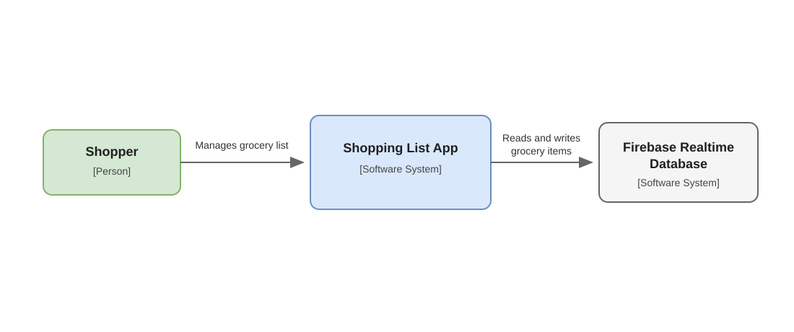

# Architecture

## High-Level Overview

- **Purpose**: A browser-based grocery list for viewing, searching, adding, categorizing, and marking grocery items as bought.
- **Languages**: TypeScript (4.9.5), JavaScript, and CSS.
- **Frameworks and libraries**: React 16.8.6, Create React App / `react-scripts` 5.0.1, Material-UI 4, and Firebase SDK 8.10.1.
- **Package manager**: npm; dependencies and scripts are declared in `package.json` and `package-lock.json`.
- **Persistence**: Firebase Realtime Database, accessed through the Firebase client SDK. There is no project-owned backend or local database service.
- **Local development**: Use Node.js 22.x, install with `node scripts/run_installpackages.js`, and start with `node scripts/run_start.js`. The app needs network access and a reachable Firebase database for grocery data.

## Architecture

### Style and building blocks

The application is a single-page React client. `src/index.tsx` mounts `App` and registers the service worker. `App` owns grocery-list state and Firebase reads and writes. `GroceryList` renders and edits items; `SearchDialog` filters existing items and adds new ones. `GroceryType` describes grocery records.

Components communicate through props and callbacks. Firebase access is concentrated in `App` and initialized in `src/shared/config.tsx`; there is no separate repository or service layer.

### Runtime and data flow

On mount, `App` subscribes to the Firebase `/groceries` value. It maps the returned records into grocery items and displays those not yet bought. Changes to purchase state, name, or area, and new-item creation are written through the Firebase SDK. The value subscription supplies updated records to the UI. Search filters the current in-memory list and calls back into `App` for actions.

### Security and configuration

Firebase client configuration is located in `src/shared/config.tsx`; configuration values are intentionally omitted here. The browser communicates directly with Firebase. No application authentication flow or database security rules are defined in this repository, so access control and rule enforcement must be verified in the Firebase project configuration.

### Testing and delivery

Tests use Jest through Create React App (`npm test`). Existing tests are component-render smoke tests in `src/App.test.tsx` and `src/GroceryList/GroceryList.test.tsx`; no Firebase integration tests or coverage threshold are configured.

Vercel's Git integration deploys feature branches as previews and `master` as production. `vercel.json` runs a locked dependency install, component tests, and the production build. Static output is served at the stable production domain, `https://shopping-app-pi.vercel.app`. Firebase remains the browser's external data service.

The separate legacy CircleCI configuration uses Node 8 and is not compatible with the current toolchain. It is not the Vercel deployment gate.

### ADR: Supported Node.js build without a UI migration

- **Status**: Accepted for the pipeline repair.
- **Context**: Vercel rejects Node.js 16. On Node.js 22, CRA 3's webpack 4 fails with an OpenSSL error and Firebase 6's native gRPC dependency is incompatible.
- **Decision**: Use Node.js 22, CRA 5/webpack 5, TypeScript 4.9, and Firebase 8's namespaced API. Keep React 16, component ownership, Firebase configuration, and the grocery data model unchanged. Install from the public npm registry with `npm ci`; run tests before every Vercel build.
- **Consequences**: The app builds without legacy crypto flags or disabled checks. These remain legacy application dependencies, not a full modernization. Firebase access rules and runtime availability still require separate validation.

### C4 system context

The diagram keeps the system boundary at the shopping-list application and shows only its direct user and persistence system, following the [C4 system-context guidance](https://c4model.com/diagrams/system-context). The editable source is [`architecture.drawio`](./architecture.drawio).

## External Context

### Firebase Realtime Database

- **Role**: Runtime persistence for grocery records under `/groceries`.
- **Source/configuration**: Firebase SDK dependency in `package.json`; client initialization in `src/shared/config.tsx` (values omitted).
- **Boundary**: The browser application reads and writes directly through the Firebase SDK; no application API sits between them.
- **Unresolved assumptions**: Authentication and database rules are not represented in this repository and must be checked in the Firebase project.

### Vercel

- **Role**: Git-driven preview and production hosting.
- **Source/configuration**: `vercel.json`, Node engine in `package.json`, and Vercel project `shopping-app-67k0` linked to `bernhardwhy/shopping-app`.
- **Boundary**: Builds and serves static frontend assets; it does not host or proxy the Firebase database.
- **Release**: Merge a verified feature preview into `master` to update the stable domain. See the [deployment guide](../README.md#deployment).

### CircleCI (legacy)

- **Role**: Continuous integration for dependency installation and test/coverage reporting.
- **Source/configuration**: `.circleci/config.yml`.
- **Boundary**: CircleCI checks out the repository and runs npm commands; no deployment or runtime traffic is configured.
- **Unresolved assumptions**: Whether this legacy integration remains enabled is not verified. Deployment is handled by Vercel.

### Public npm registry

- **Role**: Public application and build-tool dependency installation.
- **Source/configuration**: Root `.npmrc`.
- **Boundary**: npm resolves the committed lockfile against `https://registry.npmjs.org/`; cloud builds need no private feed credentials.
